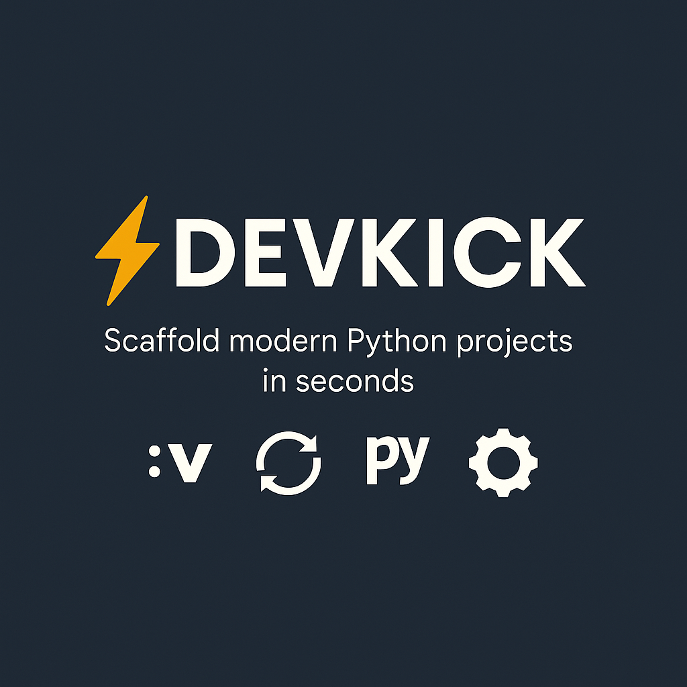

# Devkick

**Scaffold a clean Python project with pyenv, Poetry, direnv, a Makefile, tests, and CI in one command.**

[Repository](https://github.com/nyght-x-walker/devkick) · [Generated sample](https://github.com/nyght-x-walker/devkick_my-awesome-project) · [MIT License](LICENSE)



## Why Devkick

Setting up a Python project usually means repeating the same setup: pin a Python version, create a virtual environment, wire dependencies, add a test runner, and remember the CI file. Devkick turns that into one command.

## Requirements

- [pyenv](https://github.com/pyenv/pyenv)
- [Poetry](https://python-poetry.org/docs/#installation)
- [direnv](https://direnv.net/)

## Quick start

```bash
chmod +x devkick.sh
./devkick.sh my-project
cd my-project
make setup
make run
```

The project name is optional and defaults to `devkick`.

## What you get

- `.python-version` pinned to the active Python version
- `pyproject.toml` managed with Poetry
- `.envrc` wired for direnv
- `app/` and `tests/` starter layout
- A Makefile with `setup`, `run`, `test`, `lint`, and `coverage`
- GitHub Actions CI for tests and coverage
- `requirements.txt` export for tooling that does not use Poetry
- MIT license and a starter README

## Make targets

```bash
make setup     # install dependencies
make run       # run app/main.py
make test      # run pytest
make lint      # run black
make coverage  # run coverage and print a report
```

## Notes

Devkick is intentionally small and shell-based. It is a starting point, not a framework; edit the generated files to fit the project.
